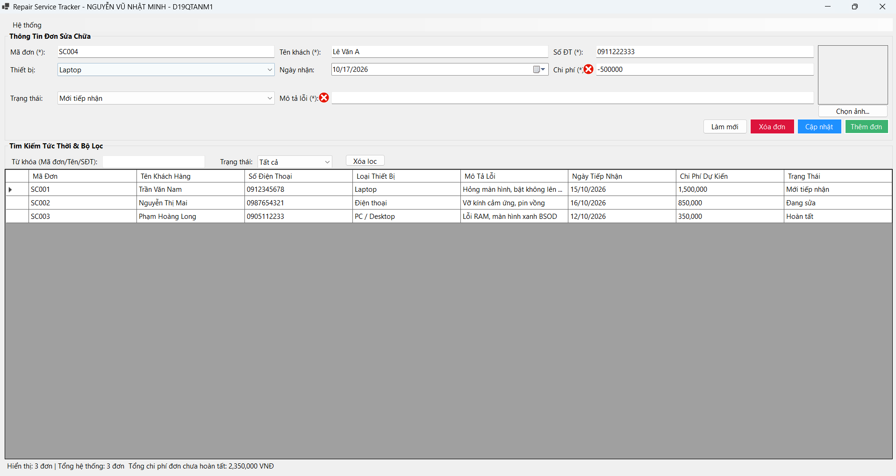
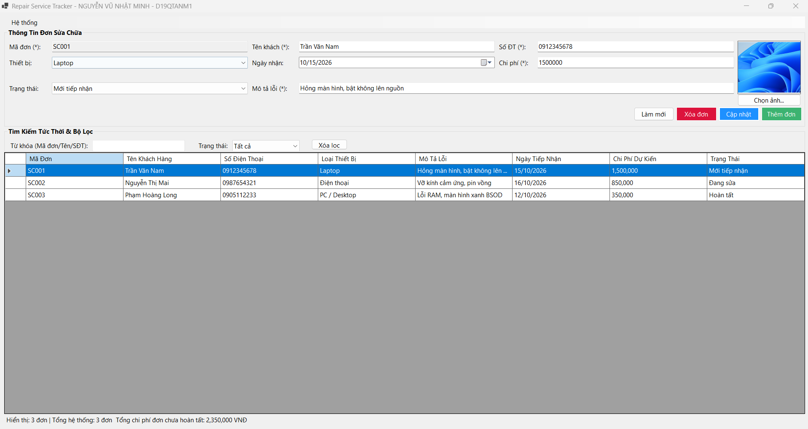
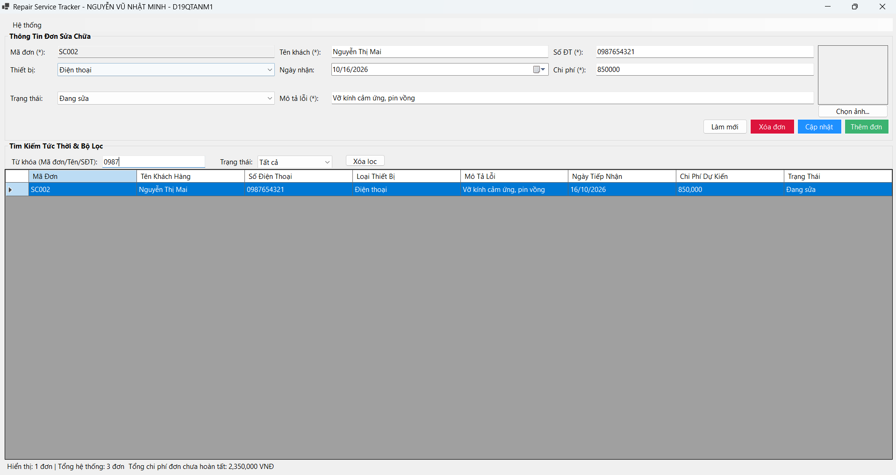
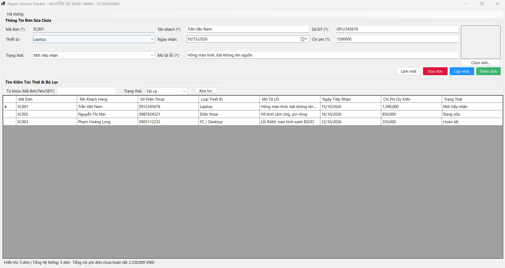
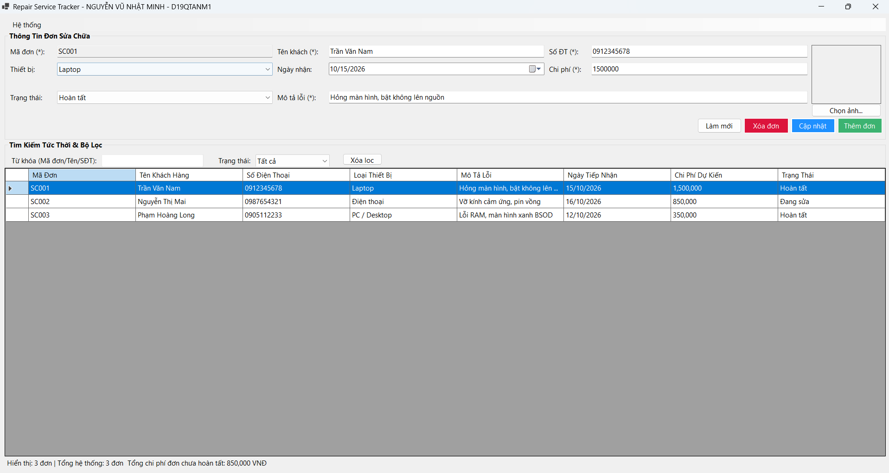

# BÁO CÁO BÀI TẬP / ĐỒ ÁN

## THÔNG TIN SINH VIÊN
- **Họ và tên:** Nguyễn Vũ Nhật Minh
- **Mã số sinh viên:** 24810320314
- **Lớp:** D19QTANM1
- **Tên môn học:** Lập trình C# / Windows Forms
- **Tên bài tập:** BÀI TẬP 4.11: Quản lý đơn đăng ký dịch vụ sửa chữa (Repair Service Tracker)

---

## KẾT QUẢ THỰC HÀNH & KIỂM THỬ

### 1. Không cho lưu chi phí âm hoặc thiếu mô tả lỗi

### 2. Ảnh đã chọn hiển thị không méo;

### 3. Tìm kiếm và lọc trạng thái cho kết quả chính xác

### 4. Trạng thái và tổng chi phí trên StatusStrip trước khi cập nhật

### 5. Tổng chi phí trên StatusStrip thay đổi sau khi cập nhật trạng thái hoặc chi phí

---